# تك زون للإلكترونيات — TechZone POS & Shop OS

نظام متكامل واحترافي لنقاط البيع، إدارة المبيعات، عروض الأسعار، حسابات العملاء الآجلة، الصيانة، وشراء الأجهزة المستعملة. يعمل **offline بالكامل** وبواجهة نظام تشغيل هجينة متطورة (**TechZone OS — مستوحاة من تناغم Windows 11 و macOS**) داخل نافذة سطح مكتب واحدة فائقة السرعة، ومُهيأ خصيصاً للسوق المصري (`ج.م` / ضريبة 14% قابلة للتفعيل أو الإلغاء التام).

---

## فهرس المحتويات

1. [نظرة عامة وفلسفة النظام](#-نظرة-عامة-وفلسفة-النظام)
2. [معرض الشاشات ودليل الاستخدام الشامل](#-معرض-الشاشات-ودليل-الاستخدام-الشامل)
   - [1. شاشة تسجيل الدخول الذكية](#1-شاشة-تسجيل-الدخول-الذكية-indexhtml)
   - [2. سطح المكتب ونظام تشغيل تك زون (TechZone OS)](#2-سطح-المكتب-ونظام-تشغيل-تك-زون-desktophtml)
   - [3. شاشة نقاط البيع السريعة (الكاشير)](#3-شاشة-نقاط-البيع-السريعة-الكاشير-poshtml)
   - [4. المبيعات وعروض الأسعار الرسمية (A4)](#4-المبيعات-وعروض-الأسعار-الرسمية-a4-sales_quoteshtml)
   - [5. إدارة المخزون والأصناف والسيريال](#5-إدارة-المخزون-والأصناف-والسيريال-inventoryhtml)
   - [6. العملاء والحسابات والمديونيات الآجلة](#6-العملاء-والحسابات-والمديونيات-الآجلة-customershtml)
   - [7. كشف حساب العميل التفصيلي وسندات القبض](#7-كشف-حساب-العميل-التفصيلي-وسندات-القبض-customer_detailshtml)
   - [8. مركز الصيانة وتذاكر الإصلاح](#8-مركز-الصيانة-وتذاكر-الإصلاح-repairhtml)
   - [9. شراء الأجهزة المستعملة والفحص](#9-شراء-الأجهزة-المستعملة-والفحص-buy_usedhtml)
   - [10. سجل العمليات والمبيعات الشامل والفلترة](#10-سجل-العمليات-والمبيعات-الشامل-والفلترة-historyhtml)
   - [11. التقارير المالية وجرد الورديات والأرباح](#11-التقارير-المالية-وجرد-الورديات-والأرباح-reportshtml)
   - [12. إدارة الموظفين وتخصيص الصلاحيات الـ 16](#12-إدارة-الموظفين-وتخصيص-الصلاحيات-الـ-16-staffhtml)
   - [13. الملف الشخصي وإعدادات الموظف والمظهر](#13-الملف-الشخصي-وإعدادات-الموظف-والمظهر-profilehtml)
   - [14. إعدادات المتجر والضريبة وطرق الدفع](#14-إعدادات-المتجر-والضريبة-وطرق-الدفع-settingshtmltabstore)
   - [15. استوديو تصميم الفواتير وقوالب الطباعة الموحد](#15-استوديو-تصميم-الفواتير-وقوالب-الطباعة-الموحد-settingshtmltabinvoices)
   - [16. معاينة وطباعة الإيصال والمشاركة عبر واتساب](#16-معاينة-وطباعة-الإيصال-والمشاركة-عبر-واتساب-receipthtml)
3. [أبرز المميزات والخصائص الاستثنائية](#-أبرز-المميزات-والخصائص-الاستثنائية)
4. [البنية التقنية والمعمارية](#-البنية-التقنية-والمعمارية)
5. [متطلبات التشغيل والتثبيت](#-متطلبات-التشغيل-والتثبيت)
6. [حسابات الدخول الافتراضية](#-حسابات-الدخول-الافتراضية)

---

## 🌟 نظرة عامة وفلسفة النظام

تم تصميم **تك زون للإلكترونيات** ليكون الحل الأقوى والأبسط لإدارة متاجر التكنولوجيا ومراكز صيانة الأجهزة الإلكترونية؛ حيث يجمع بين:
- **الاستقلالية التامة**: يعمل محلياً 100% دون الحاجة إلى اتصال بالإنترنت أو اشتراكات سحابية، مع تخزين آمن وسريع على قاعدة بيانات `SQLite`.
- **تجربة مستخدم حية ومرنة (TechZone OS)**: سطح مكتب افتراضي متعدد النوافذ، شريط مهام، Dock سفلي، قائمة ابدأ، وودجات تفاعلية.
- **التوافق التام مع السوق المصري**: التعامل بالجنيه المصري (`ج.م`)، وحسابات المحافظ الإلكترونية (فودافون كاش، إنستا باي، أورنج كاش)، ودعم كامل لضريبة القيمة المضافة 14% مع إمكانية إيقافها كلياً للمحلات المعفاة.
- **حماية الأمان والدورة المالية**: حماية ضد محاولات التخمين برمز PIN، وصلاحيات مخصصة مقسمة بدقة إلى 16 صلاحية فردية لكل موظف، مع منع حذف الفواتير الرسمية وحصر التعديل في نظام المرتجعات الموثقة.

---

## 📸 معرض الشاشات ودليل الاستخدام الشامل

### 1. شاشة تسجيل الدخول الذكية (`index.html`)

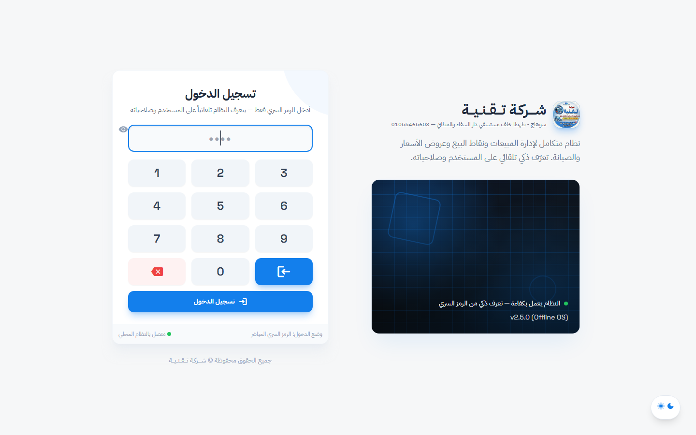

- **التعرف التلقائي على المستخدم**: بمجرد كتابة الرمز السري (PIN) من لوحة الأرقام أو الكيبورد، يتعرف النظام تلقائياً على هوية الموظف وصلاحياته ودوره (مدير أو كاشير) دون الحاجة لاختيار الاسم أو الكشف عن صفته.
- **عرض هوية المتجر**: يظهر اسم المحل وشعاره الرسمي المرفوع من الإعدادات ديناميكياً.
- **3 أوضاع دخول مرنة يحددها الأدمن**:
  1. *الرمز السري فقط (PIN Only)*: الأسرع في المحلات اليومية.
  2. *اختيار الموظف + الرمز السري*: بطاقات مصغرة لاختيار اسم الموظف ثم كتابة رمزه.
  3. *اسم المستخدم وكلمة السر*: للدخول التقليدي المعتاد.
- **حماية أمنية من التخمين (Brute-Force Lockout)**: قفل الإدخال تلقائياً بعد عدد محدد من المحاولات الفاشلة مع عدّاد زمني تنازلي يظهر للمستخدم ولا يمكن تجاوزه حتى بإعادة تشغيل البرنامج.

---

### 2. سطح المكتب ونظام تشغيل تك زون (`desktop.html`)

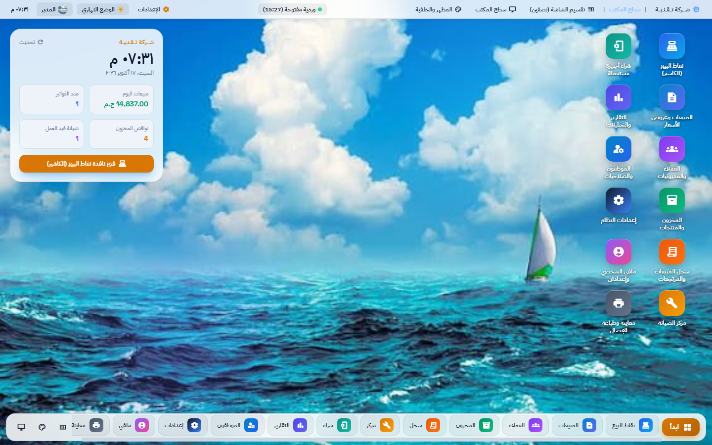

- **واجهة نظام تشغيل كاملة (TechZone OS)**:
  - **الشريط العلوي (Top Bar)**: يضم اسم المتجر، المظهر والوضع الليلي، مؤشر الوردية المفتوحة ووقتها، اختصارات الإعدادات، والملف الشخصي للموظف.
  - **ودجات حية (Live Widgets)**: توقيت حي بالتقويم، إجمالي مبيعات اليوم، عدد الفواتير الصادرة، تذاكر الصيانة الجارية، وتنبيهات نواقص المخزون مع زر فتح سريع للكاشير.
  - **أيقونات سطح المكتب القابلة للسحب والترتيب**: تشغيل أي تطبيق بضغطة واحدة مع إمكانية إعادة الترتيب وحفظ موضع الأيقونات تلقائياً لكل مستخدم.
  - **شريط المهام وقائمة ابدأ (Start Menu)**: قائمة ابدأ تعرض معلومات المستخدم النشط والوصول السريع لكل صفحات النظام وتطبيقاته.
  - **الـ Dock السفلي العائم**: محاكاة لـ Dock نظام macOS للتبديل بين النوافذ وتصغيرها وتكبيرها بسلاسة تامة.
  - **تعدد النوافذ المتجاوبة (Multi-Window)**: إمكانية فتح أكثر من نافذة في وقت واحد (مثل فتح الكاشير بجانب كشف حساب عميل أو تذكرة صيانة) ونقلها وتكبيرها دون فقدان البيانات.

---

### 3. شاشة نقاط البيع السريعة (الكاشير) (`pos.html`)

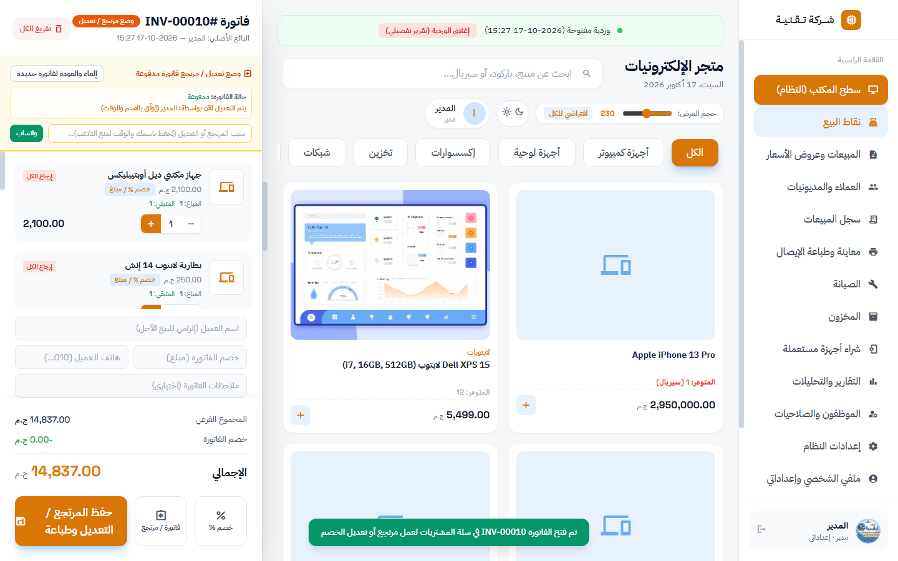

- **كتالوج بصري وتصفية سريعة بالفئات**: تصفح المنتجات بأيقونات وصور واضحة مع إمكانية تغيير حجم بلوكات العرض (Slider) لتناسب شاشات اللمس وشاشات الكمبيوتر.
- **بحث فوري شامل**: يدعم البحث باسم المنتج، كود الـ SKU، أو السيريال نمبر بالأجهزة المتتبعة.
- **سلة مشتريات ذكية**:
  - حساب فوري للإجمالي والخصم والضرائب.
  - زر تعديل الخصم على مستوى البند الواحد أو الفاتورة ككل (وفق صلاحية الكاشير).
  - إمكانية فتح أي فاتورة سابقة في السلة لإجراء **مرتجع كلي أو جزئي** مع توثيق اسم المعدل وتاريخ التعديل ومنع التلاعب.
- **حساب الفكة والباقي تلقائياً**: عند إدخال مبلغ نقدي أكبر من الفاتورة، يُحسب الباقي المستحق للعميل ويُطبع في الإيصال.
- **التحويل الذكي إلى بيع آجل**: عند إدخال مبلغ أقل من القيمة، يوجه النظام الكاشير لاختيار أو تسجيل العميل ليُرحل المتبقي تلقائياً كمديونية في كشف حسابه.
- **دعم المحافظ الإلكترونية**: حقل مخصص لكتابة رقم العملية المرجعية (Ref No) لفودافون كاش أو إنستا باي لربط الإيداع بالحساب البنكي.

---

### 4. المبيعات وعروض الأسعار الرسمية (A4) (`sales_quotes.html`)

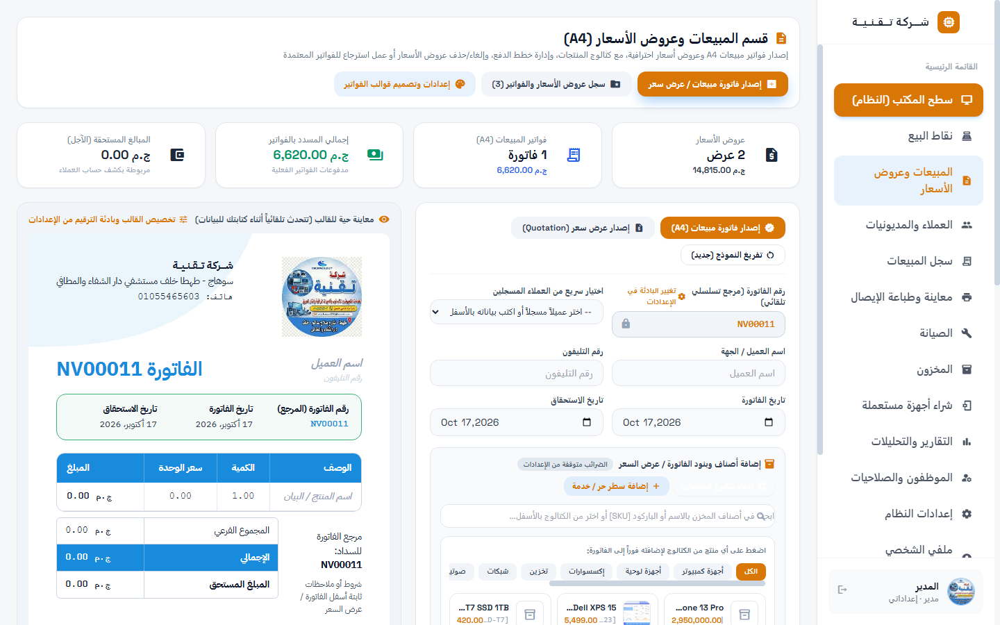

- **إصدار الفواتير الرسمية وعروض الأسعار (Quotations)**: نموذج احترافي للشركات والمؤسسات والتعاملات الكبرى (B2B).
- **معاينة حية ومباشرة**: أثناء كتابة البيانات وتحديد المنتجات، تظهر الفاتورة بتصميمها الحقيقي على جانب الشاشة متضمنة الشعار والألوان وشروط الدفع والضمان.
- **تحويل عرض السعر إلى فاتورة بيع بضغطة زر**: تحويل أي عرض سعر معتمد إلى فاتورة مبيعات مع تسجيل الدفعة النقدية المسددة، وترحيل المتبقي إلى آجل، وخصم البضاعة من المخزون فورياً.
- **حماية الدورة المالية**: إمكانية إلغاء أو حذف عروض الأسعار المسودة، مع حماية الفواتير المحولة والمعتمدة من الحذف العشوائي وتوفير خيارات المرتجع الرسمي الموثق.

---

### 5. إدارة المخزون والأصناف والسيريال (`inventory.html`)

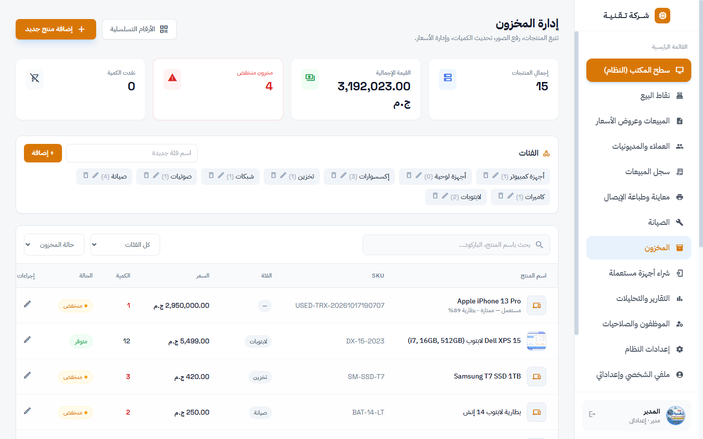

- **كروت إحصائية علوية شاملة**: عرض إجمالي المنتجات المسجلة، القيمة المالية الإجمالية للمخزون بسعر الشراء/البيع، تنبيهات الأصناف منخفضة الكمية، والمنتجات التي نفدت بالكامل.
- **إدارة الفئات والأقسام**: شريط فئات مرن لإضافة وحذف وتعديل الأقسام (كمبيوتر، لابتوبات، شبكات، إكسسوارات، هواتف، صيانة...).
- **تتبع السيريال نمبر (Serial Tracking)**: تتبع دقيق للأجهزة باهظة الثمن (مثل اللابتوبات والهواتف) من لحظة الشراء وحتى البيع أو الصيانة برقم السيريال الفريد.
- **رفع صور المنتجات وتعديل الأسعار**: إمكانية إضافة صور مصغرة لكل منتج، ضبط سعر التكلفة وسعر البيع، وتحديد حد أدنى للكمية لتنبيه الإدارة بالنواقص قبل نفادها.

---

### 6. العملاء والحسابات والمديونيات الآجلة (`customers.html`)

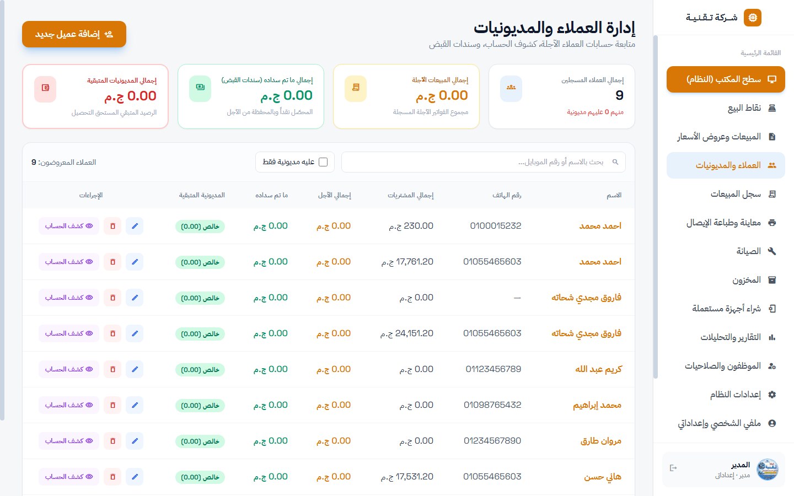

- **دليل شامل لبيانات العملاء**: تسجيل أسماء العملاء، أرقام الهواتف، العناوين، وملاحظات التعامل.
- **متابعة المديونيات في الوقت الفعلي**: كروت إحصائية ملونة توضح:
  - إجمالي المبيعات الآجلة على مستوى المحل.
  - إجمالي ما تم سداده عبر سندات القبض.
  - إجمالي المديونيات المتبقية المستحقة للتحصيل.
- **فلتر سريع «عليه مديونية فقط»**: إظهار العملاء المطالبين بمبالغ مالية فقط بضغطة زر لسهولة المتابعة والتحصيل الدوري.
- **الوصول المباشر لكشف الحساب وسندات القبض**: زر سريع لفتح كشف الحساب التفصيلي لكل عميل أو تعديل بياناته.

---

### 7. كشف حساب العميل التفصيلي وسندات القبض (`customer_details.html`)

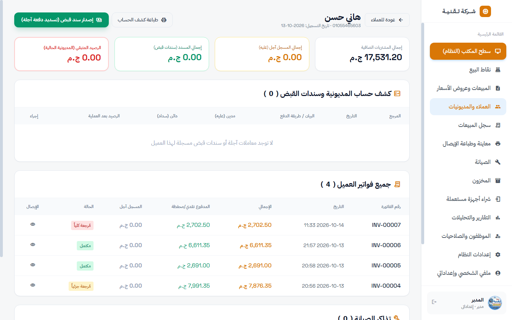

- **كشف حساب مالي تفصيلي (Ledger)**: سجل زمني دقيق لكل حركة تمت مع العميل (فواتير بيع آجل، دفعات نقدية مسددة، تحويلات محفظة إلكترونية، ومرتجعات).
- **إصدار سندات القبض (`RCV-...`)**: تحصيل دفعات من الحساب الآجل نقداً أو عبر محفظة إلكترونية مع إصدار إيصال سند قبض رسمي برقم تسلسلي خاص.
- **طباعة كشف الحساب الرسمي**: إمكانية طباعة كشف الحساب بضغطة زر بتنسيق أنيق يشمل الرصيد التراكمي وتفاصيل كل عملية لتسليمه للعميل.

---

### 8. مركز الصيانة وتذاكر الإصلاح (`repair.html`)

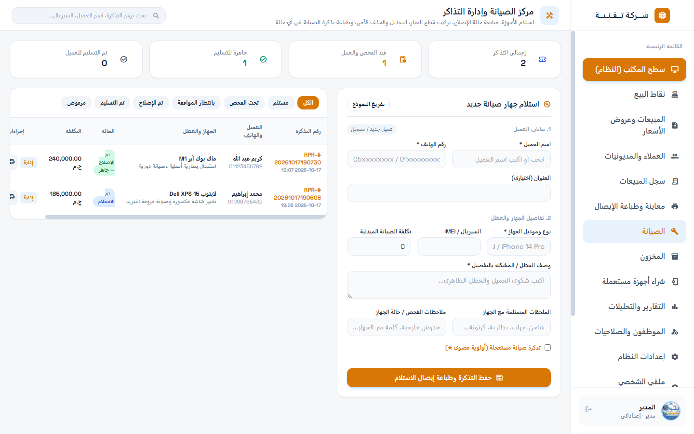

- **دورة حياة تذكرة الصيانة المتكاملة**:
  - `مستلم (received)`: استلام الجهاز وتسجيل الملحقات والشكوى بالتفصيل.
  - `تحت الفحص (in_review)`: فحص العطل الفني وتقدير التكلفة.
  - `بانتظار الموافقة (pending_approval)`: إبلاغ العميل بالتكلفة واعتماد الإصلاح.
  - `تم الإصلاح - جاهز (repaired)`: انتهاء الصيانة بنجاح وإشعار العميل للاستلام.
  - `تم التسليم (delivered)`: تسليم الجهاز وتحصيل الرسوم أو تسجيلها آجل.
  - `مرفوض / غير قابل للإصلاح (rejected)`: توثيق سبب الرفض وإعادة الجهاز للعميل.
- **ربط قطع الغيار بالمخزون**: خصم قطع الغيار المستخدمة في الصيانة (شاشات، بطاريات، هاردات) من مخزون المحل آلياً وتضمين تكلفتها في فاتورة الصيانة.
- **طباعة إيصال استلام الصيانة في أي وقت**: طباعة إيصال حراري رسمي (`RPR-...`) متضمن شروط الضمان وتفاصيل العطل لتسليم العميل نسخة منه.

---

### 9. شراء الأجهزة المستعملة والفحص (`buy_used.html`)

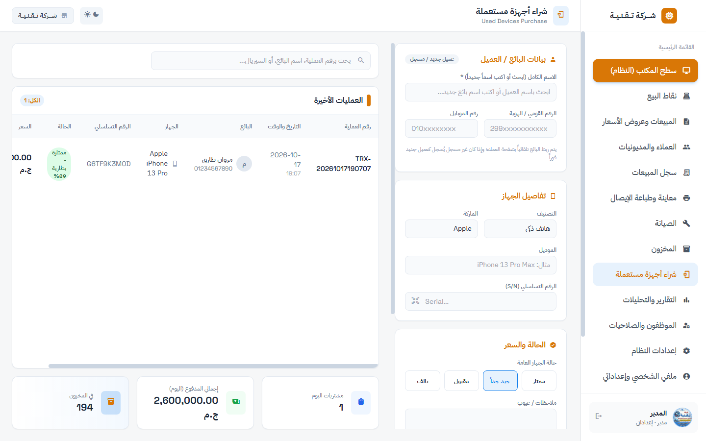

- **شراء وتبديل الأجهزة الإلكترونية (Trade-In)**: نظام مخصص لتسجيل شراء الأجهزة المستعملة من الزبائن (لابتوبات، هواتف، شاشات، قطع هاردوير).
- **الربط التلقائي بسجل العملاء**: تسجيل أو استدعاء بيانات البائع بالاسم ورقم الهاتف تلقائياً مع توثيق الرقم القومي لمنع شراء الأجهزة المسروقة أو مجهولة المصدر.
- **فحص الحالة الفنية وتسجيل السيريال**: توثيق حالة الجهاز (ممتاز، جيد، به خدوش، تالف)، وتسجيل السيريال نمبر وسعر الشراء وسعر البيع المتوقع.
- **إضافة الجهاز للمخزون آلياً**: إمكانية ترحيل الجهاز المستعمل فورياً إلى جدول المنتجات في المخزون ليصبح متاحاً للبيع في شاشة الكاشير مع وسم "مستعمل".

---

### 10. سجل العمليات والمبيعات الشامل والفلترة (`history.html`)

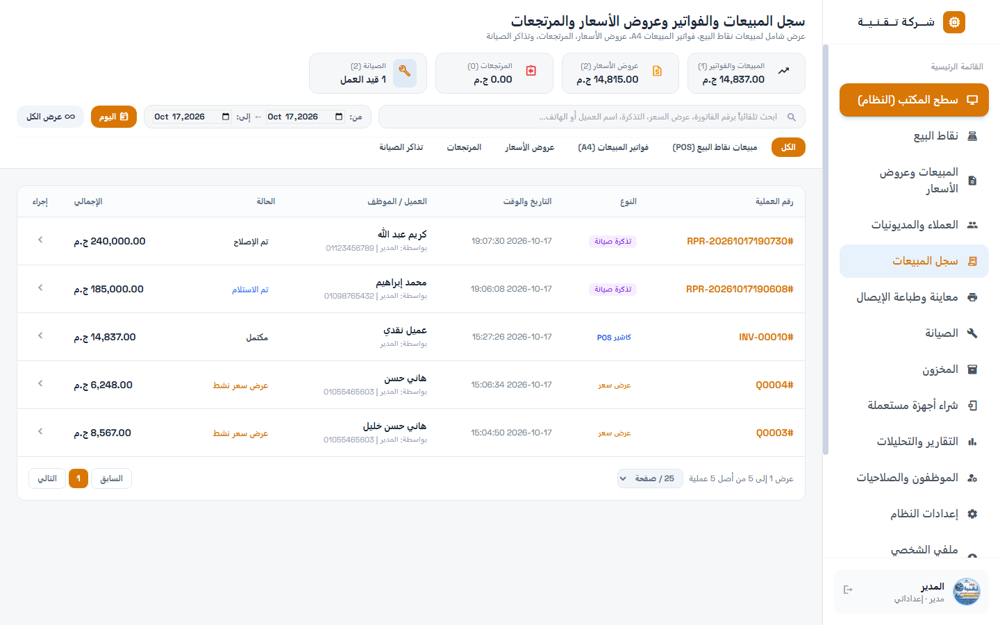

- **سجل مركزي موحد**: يجمع كافة حركات النظام في جدول واحد ذكي:
  - مبيعات الكاشير السريعة (POS).
  - الفواتير الرسمية الكبرى (A4).
  - عروض الأسعار (Quotations).
  - فواتير المرتجعات (Returns).
  - تذاكر ومقبوضات الصيانة (Repairs).
- **فلترة متقدمة من تاريخ إلى تاريخ**: اختيار فترة زمنية مخصصة («من تاريخ» و«إلى تاريخ»)، أو الفلترة على مبيعات اليوم فقط، أو عرض كافة العمليات المسجلة.
- **بحث أتوكمبليت فوري**: البحث برقم الفاتورة، اسم العميل، رقم الهاتف، أو اسم الكاشير.
- **ترقيم الصفحات وتصدير البيانات**: تصفح سريع ومرن بمحدد عدد الصفحات (25، 50، 100 عملية في الصفحة).

---

### 11. التقارير المالية وجرد الورديات والأرباح (`reports.html`)

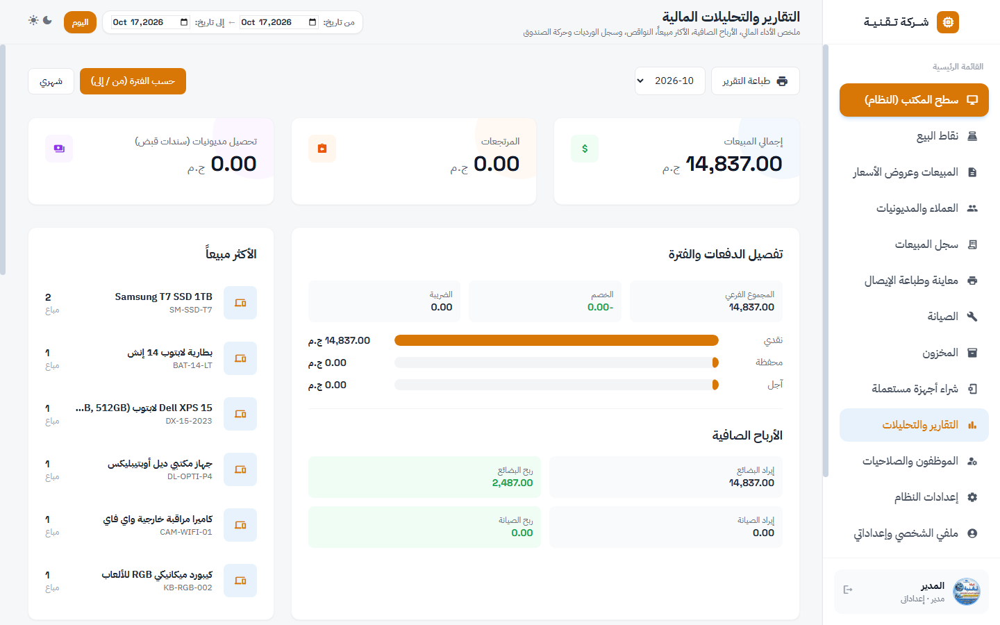

- **تحليلات الأداء المالي**:
  - إجمالي المبيعات، المرتجعات الصافية، والتحصيلات النقدية والآجلة.
  - **حساب الأرباح الصافية**: حساب دقيق للربح الصافي للبضائع المباعة (سعر البيع - سعر التكلفة) مع فصل أرباح الصيانة لتقييم دخل الورشة.
- **المنتجات الأكثر مبيعاً (Top Sellers)**: جدول بياني يوضح الأصناف الأكثر طلباً في المتجر لتنظيم عمليات الشراء والتوريد.
- **تقرير الورديات وجرد الصندوق**: تسجيل فتح وإغلاق الورديات، النقدية الفعلية المحصية، النقدية المتوقعة، وفروقات العجز والزيادة مع توثيق اسم الكاشير ووقت الفتح والإغلاق.

---

### 12. إدارة الموظفين وتخصيص الصلاحيات الـ 16 (`staff.html`)

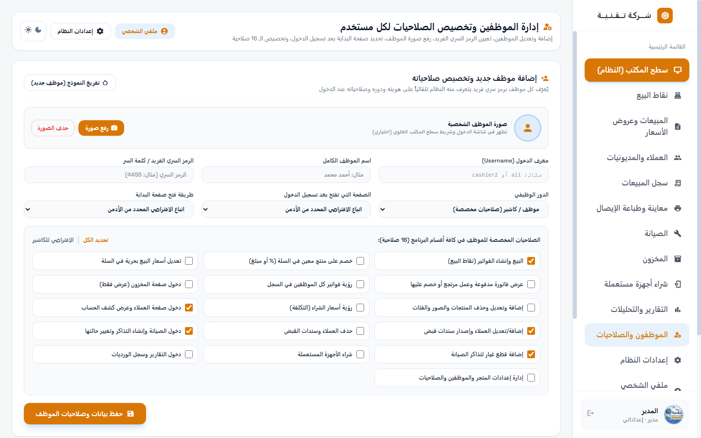

- **فصل كامل لإدارة فريق العمل**: شاشة مستقلة للأدمن لإضافة الموظفين وتعديل بياناتهم وتعيين الرمز السري الخاص بكل منهم.
- **مصفوفة الـ 16 صلاحية المخصصة (Granular Permissions)**:
  1. `pos_sell`: البيع وإنشاء الفواتير في الكاشير.
  2. `pos_price`: تعديل أسعار البيع بحرية داخل السلة.
  3. `pos_item_discount`: عمل خصم على صنف محدد في السلة.
  4. `sales_return`: عرض فواتير سابقة وعمل مرتجع أو تعديل.
  5. `sales_all`: رؤية فواتير ومبيعات كل الموظفين في السجل.
  6. `inventory_view`: دخول شاشة المخزون (عرض فقط).
  7. `inventory_edit`: إضافة وتعديل وحذف المنتجات والصور والفئات.
  8. `cost_view`: رؤية أسعار الشراء والتكلفة وهوامش الربح.
  9. `customers_view`: دخول صفحة العملاء وعرض كشوفات الحساب.
  10. `customers_edit`: إضافة وتعديل العملاء وإصدار سندات القبض.
  11. `customers_delete`: حذف العملاء وسندات القبض المسجلة.
  12. `repair_view`: دخول مركز الصيانة ومتابعة التذاكر وحالتها.
  13. `repair_edit`: استلام أجهزة جديدة وتعديل التذاكر وتغيير الحالة.
  14. `repair_parts`: إضافة واستخدام قطع غيار المخزون في الصيانة.
  15. `used_manage`: شراء واستلام الأجهزة المستعملة.
  16. `reports_view`: الاطلاع على التقارير المالية والأرباح وسجل الورديات.
  17. `settings_manage`: إدارة إعدادات المتجر والضرائب والفواتير والموظفين.

---

### 13. الملف الشخصي وإعدادات الموظف والمظهر (`profile.html`)

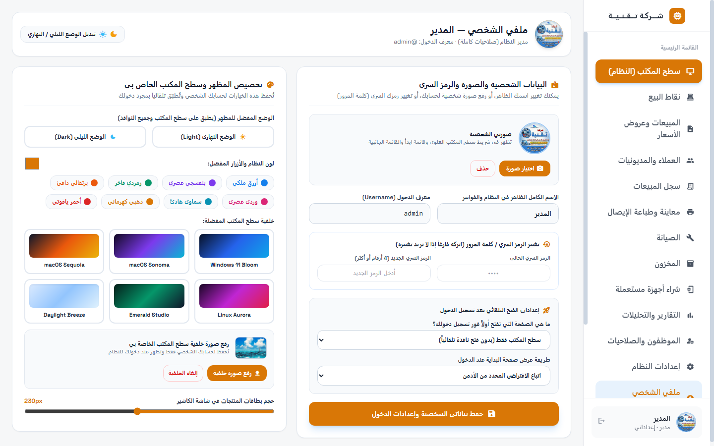

- **الملف الشخصي المستقل لكل مستخدم**: يفتح عند الضغط على اسم الموظف أو صورته في الشريط العلوي أو قائمة ابدأ.
- **تغيير الرمز السري والصورة الشخصية**: يغير الموظف رمزه السري وصورته دون الحاجة للرجوع للأدمن.
- **تخصيص سطح المكتب الخاص (TechZone OS Personalization)**:
  - اختيار المظهر (نهاري فاتح / ليلي داكن).
  - اختيار اللون المميز للنظام (Accent Color) من بين 8 درجات فاخرة.
  - اختيار خلفية سطح المكتب من بين الخلفيات المدمجة أو **رفع صورة خلفية خاصة به** من جهازه تُحفظ لحسابه فقط.
  - تحديد صفحة البداية المفضلة (مثل فتح الكاشير أو سطح المكتب تلقائياً بعد تسجيل الدخول).
  - ضبط حجم كروت المنتجات الافتراضية للكاشير.

---

### 14. إعدادات المتجر والضريبة وطرق الدفع (`settings.html?tab=store`)

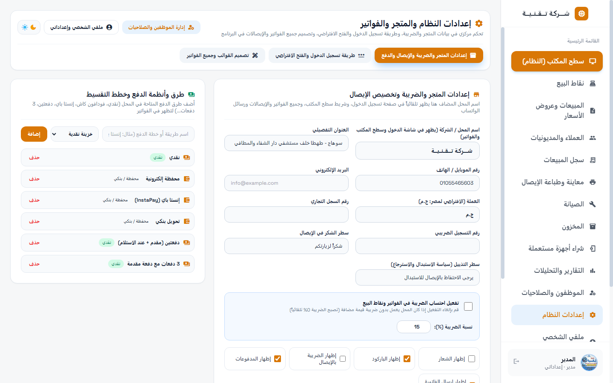

- **بيانات المحل والترويسة**: اسم المتجر، العنوان، رقم الهاتف، والبريد الإلكتروني والشعار.
- **التحكم الكامل في ضريبة القيمة المضافة (VAT)**:
  - زر إيقاف الضريبة بالكامل: عند تعطيله تختفي خانات الضرائب تماماً من فواتير البيع والكاشير وعروض الأسعار وتصبح 0% تلقائياً لتناسب المحلات غير الخاضعة للضريبة.
  - عند تفعيلها: إمكانية ضبط نسبة الضريبة (افتراضياً 14% لمصر) وحسابها بدقة على الأصناف الخاضعة.
- **إدارة طرق الدفع وأنظمة التقسيط**: إضافة وتعديل طرق الدفع المتاحة في المتجر (نقدي، فودافون كاش، إنستا باي، تحويل بنكي، دفعات تقسيط...).

---

### 15. استوديو تصميم الفواتير وقوالب الطباعة الموحد (`settings.html?tab=invoices`)

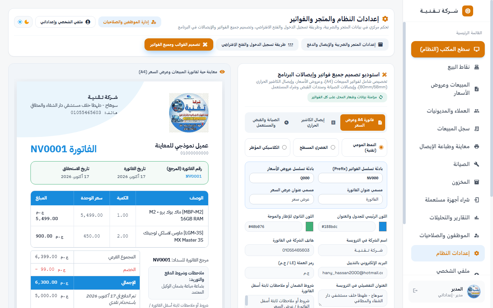

- **مصمم قوالب موحد ومتكامل**: يتيح تخصيص شكل ومظهر كافة مستندات وإيصالات البرنامج في مكان واحد:
  - **فاتورة المبيعات الرسمية وعروض الأسعار (A4)**: اختيار النمط (الموجي الحديث، الكلاسيكي المؤطر، أو العصري المسطح)، اختيار الألوان الرئيسية، بيانات الترويسة والتذييل، شروط الضمان، والبادئة التسلسلية (`INV-` أو `الفات/2026/`).
  - **إيصال الكاشير الحراري (80mm / 58mm)**: تخصيص عرض الورق، إظهار الشعار، الباركود، بيانات الكاشير، وبادئة فواتير الكاشير (`pos_invoice_prefix`).
  - **إيصالات الصيانة وسندات القبض والمستعمل**: تخصيص بادئات الترقيم التسلسلي (`repair_prefix` لتذاكر الصيانة، `voucher_prefix` لسندات القبض، و`used_prefix` لإيصالات شراء المستعمل) مع نصوص الشروط والأحكام لكل منها.
- **معاينة حية فورية**: كل تعديل في الألوان أو النصوص ينعكس لحظياً على نموذج المعاينة على جانب الشاشة قبل الحفظ.

---

### 16. معاينة وطباعة الإيصال والمشاركة عبر واتساب (`receipt.html`)

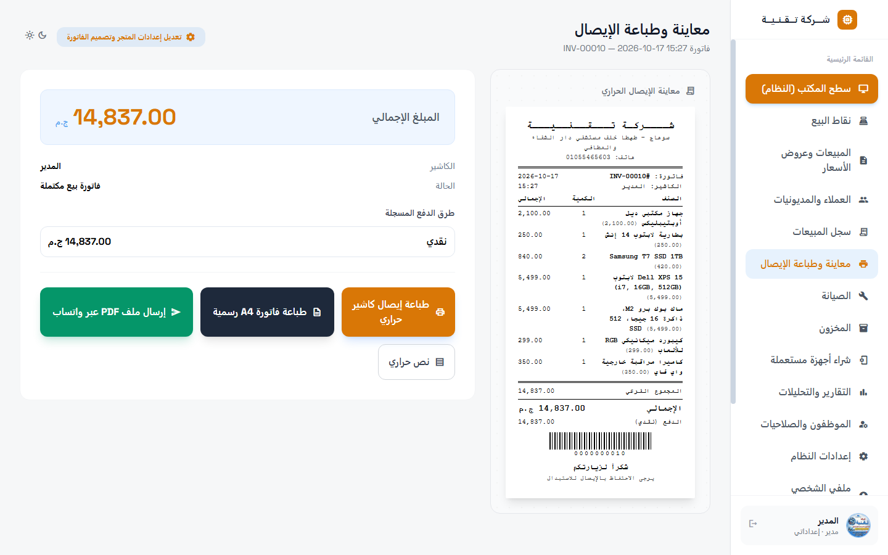

- **معاينة مطابقة تماماً للمطبوع**: عرض الفاتورة بشكل شريط حراري 80mm أو نموذج A4 رسمي مع باركود الفاتورة.
- **خيارات طباعة متعددة**:
  - زر «طباعة إيصال كاشير حراري»: طباعة فورية على طابعات الإيصالات الحرارية (Epson, Xprinter, Bixolon...).
  - زر «طباعة فاتورة A4 رسمية»: طباعة المستند الكامل على طابعات الورق المكتبي القياسي.
- **إرسال الفاتورة كـ PDF عبر واتساب بضغطة زر**:
  - توليد ملف PDF قياسي عالي الدقة للفاتورة في مجلد `data/receipts/`.
  - نسخ ملف الـ PDF مباشرة إلى حافظة ويندوز عبر Win32 API (`CF_HDROP`).
  - فتح محادثة العميل على واتساب وإلصاق الفاتورة فورياً بضغطة زر واحدة.
  - خيار في الإعدادات يتيح للمدير تفعيل أو إخفاء ميزة إرسال واتساب حسب رغبة المحل.

---

## ⚡ أبرز المميزات والخصائص الاستثنائية

| الميزة | الفائدة للمتجر |
|---|---|
| **العمل بدون إنترنت (100% Offline)** | أمان فائق واستمرارية تامة للبيع حتى في حال انقطاع شبكة الإنترنت أو الكهرباء المؤقت. |
| **واجهة نظام التشغيل الهجينة (TechZone OS)** | سرعة انتقال هائلة بين النوافذ وتعدد مهام حقيقي ينافس أحدث أنظمة التشغيل المكتبية. |
| **الدخول الذكي برمز PIN** | توفير وقت الكاشير وتسريع عمليات تسجيل الدخول بلمسة واحدة دون كشف أدوار الموظفين للعملاء. |
| **حساب الفكة والباقي آلياً** | منع الأخطاء الحسابية للكاشير أثناء التعامل مع المبالغ النقدية الكبيرة وسرعة خدمة الزبائن. |
| **الترحيل التلقائي للديون** | حفظ حقوق المحل عند دفع مبالغ غير مكتملة، مع حصر السندات وإلزامية تسجيل العميل. |
| **إشعارات ومحافظ إلكترونية** | تسجيل كود العملية المرجعي للمحافظ (InstaPay / Vodafone Cash) لمطابقة الكشوفات البنكية. |
| **تذاكر صيانة احترافية** | متابعة مراحل الإصلاح، ربط قطع الغيار بالمخزون، وطباعة إيصال استلام موثق يمنع النزاعات مع العملاء. |
| **نظام شراء المستعمل الموثق** | توثيق هوية البائع ورقم بطاقته لضمان سلامة الأجهزة قانونياً وسهولة إعادة طرحها في الكاشير. |
| **16 صلاحية دقيقة** | حماية مطلقة لأسرار المحل وأرباحه؛ كل موظف يرى ويعمل فقط في حدود الصلاحيات الممنوحة له. |
| **تصدير ومشاركة PDF بواتساب** | إرسال الفاتورة الرسمية لهاتف العميل في ثوانٍ دون الحاجة لطابعات أو أوراق إضافية. |

---

## 🛠️ البنية التقنية والمعمارية

- **لغة البرمجة**: Python 3.13.
- **قاعدة البيانات**: `sqlite3` قياسي مدمج مع مخطط علائقي مكون من 19 جدولاً وفهارس مسرّعة للبحث.
- **بيئة العرض للواجهة**: `pywebview` 6.2.1 معتمد على محرك Microsoft Edge WebView2 الحديث لأقصى درجات السرعة وانعدام استهلاك الذاكرة.
- **التكامل مع نظام Windows**: واجهة `ctypes` لنداء دوال `Win32 API` الأصلية (`user32.dll` و `kernel32.dll`) للتعامل مع الحافظة بالصيغة الثنائية `CF_HDROP`.
- **الواجهة الأمامية (Frontend)**: HTML5 دلالي، JavaScript Vanilla خفيف وخالٍ من التعقيدات والمكتبات الخارجية الثقيلة، وTailwind CSS محلي مجمّع.
- **الخطوط والأيقونات**: محلية بنسبة 100% في مجلد `web/fonts/` (خطوط Cairo و IBM Plex Sans Arabic وأيقونات Material Icons) لضمان العمل التام دون أي اتصال بالإنترنت.

---

## 🚀 متطلبات التشغيل والتثبيت

### 1. التشغيل المباشر من الكود (بيئة التطوير)

- **نظام التشغيل**: Windows 10 أو Windows 11 (64-bit).
- **Python**: إصدار 3.10 أو أحدث (يوصى بـ 3.13).

```powershell
# 1. التوجه لمجلد المشروع
cd "c:\Users\hany_\Documents\workfor ai agents\project001"

# 2. تشغيل البرنامج
python app\main.py

# 3. تشغيل الفحص الذاتي الآلي الشامل للتأكد من سلامة النظام
python app\selfcheck.py
```

### 2. بناء ملف تنفيذي جاهز (`TechZone.exe`)

- لبناء ملف تشغيل ذاتي لا يحتاج لتثبيت بايثون:
  - اضغط مرتين على الملف التنفيذي المرفق: **`build-exe.bat`**.
  - سيتم إنشاء الملف التنفيذي داخل مجلد: **`dist\TechZone.exe`**.

### 3. رفع التعديلات والتحديثات إلى GitHub

- لرفع أي تعديلات أو إضافات جديدة بضغطة زر واحدة:
  - اضغط مرتين على الملف المساعد: **`push-github.bat`**.

---

## 🔑 حسابات الدخول الافتراضية

عند بدء تشغيل النظام لأول مرة، يمكنك تسجيل الدخول باستخدام الحسابات الافتراضية التجريبية التالية:

| المستخدم | الاسم الظاهر | الدور | الرمز السري الافتراضي (PIN) | الصلاحيات |
|---|---|---|---|---|
| `admin` | **المدير** | مدير النظام (`admin`) | **`1234`** | صلاحيات كاملة غير مقيدة على كافة أقسام وإعدادات النظام |
| `cashier` | **أحمد محمد** | موظف كاشير (`cashier`) | **`1111`** | صلاحيات البيع والكاشير المحددة من قبل الإدارة |

> 💡 **ملاحظة أمنية**: يُرجى بعد تسجيل الدخول لأول مرة الدخول إلى صفحة **«ملفي الشخصي»** أو صفحة **«إدارة الموظفين»** وتغيير الرمز السري الافتراضي لضمان سرية وأمان بيانات المتجر.

---

## 📜 الترخيص والدعم الفني

- جميع الحقوق محفوظة © **شركة تقنية — تك زون للإلكترونيات** 2026.
- تم التطوير بأعلى معايير الدقة الهندسية للأنظمة المستقلة وسريعة الاستجابة.
