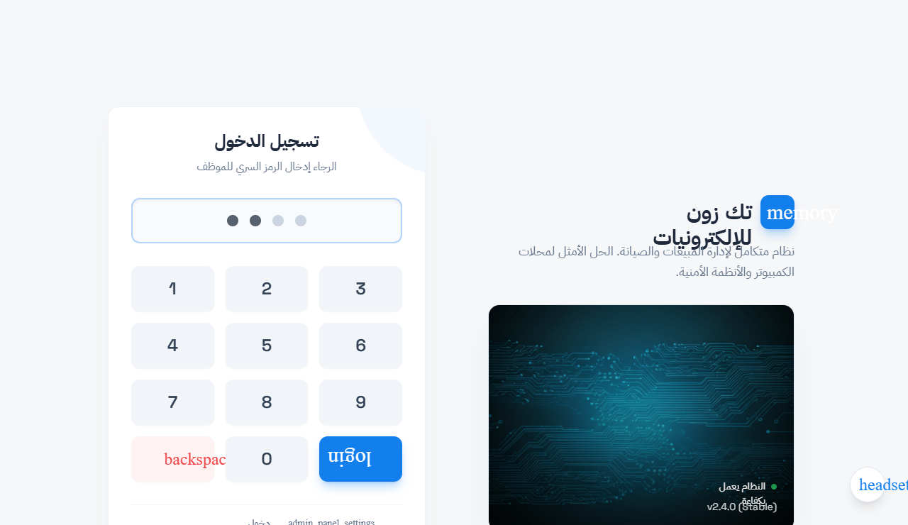
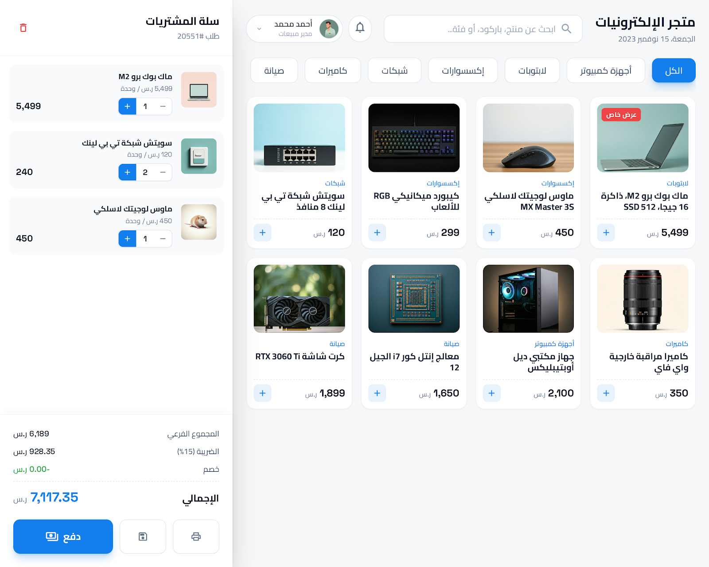
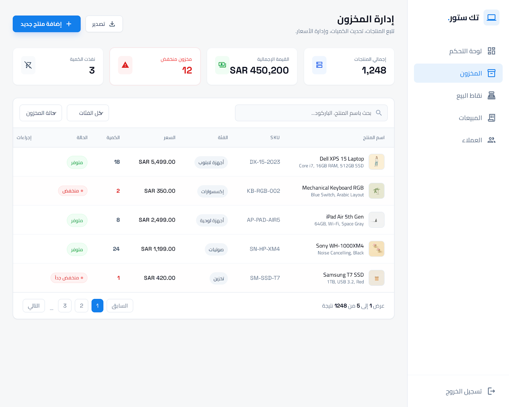
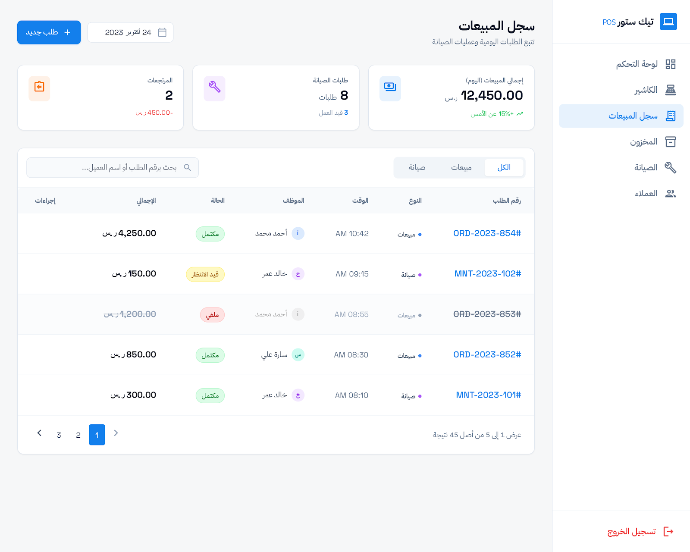
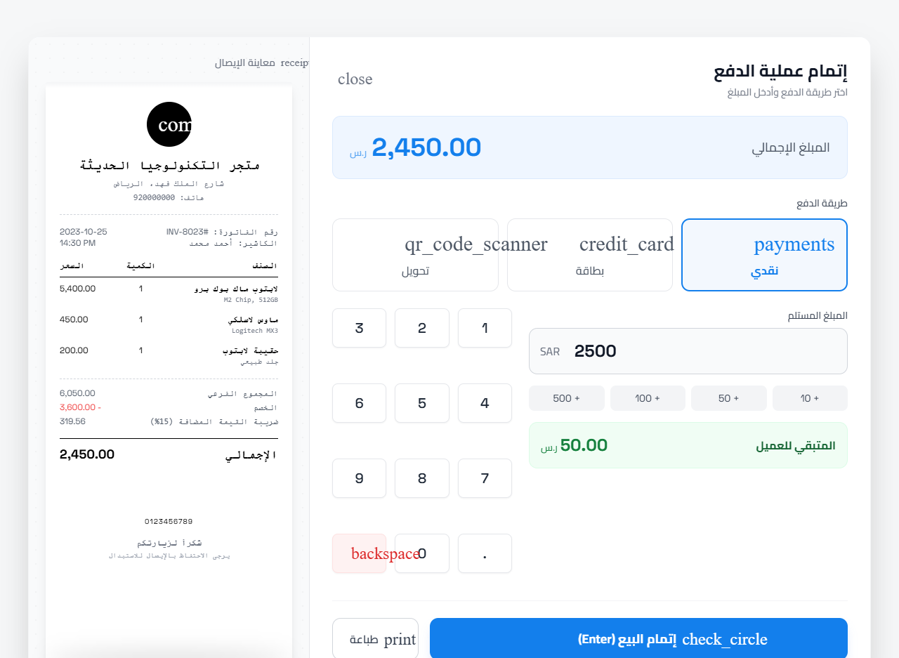
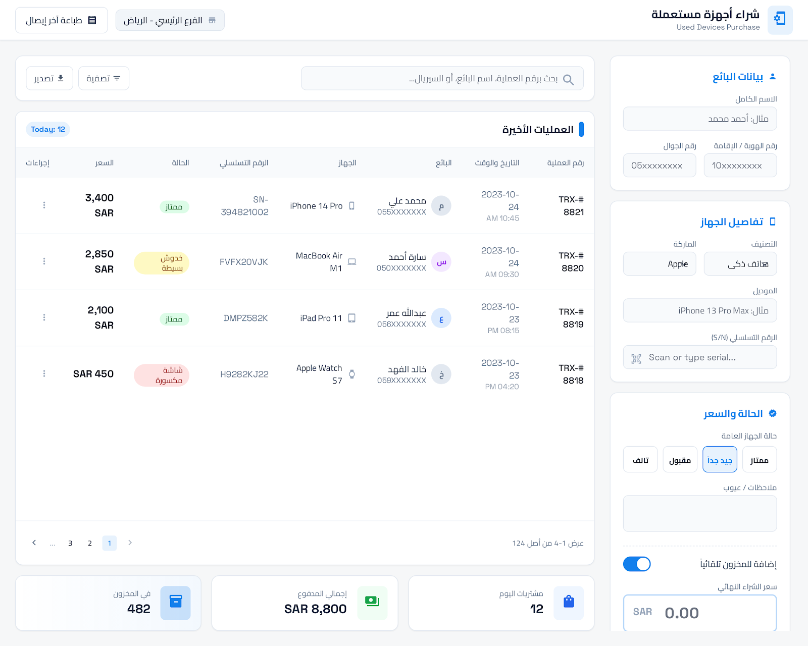
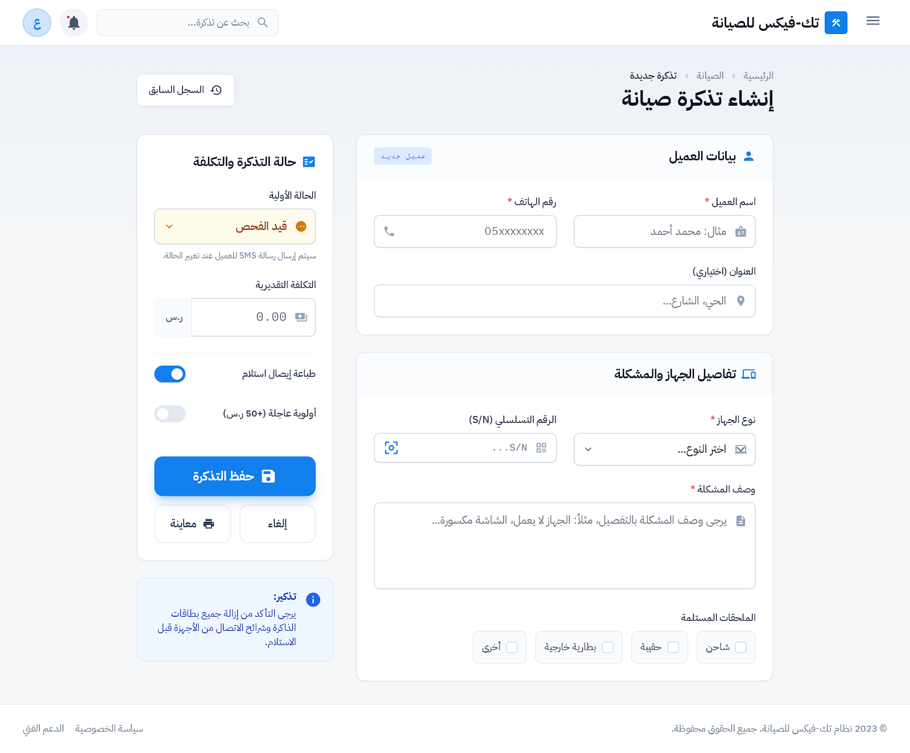
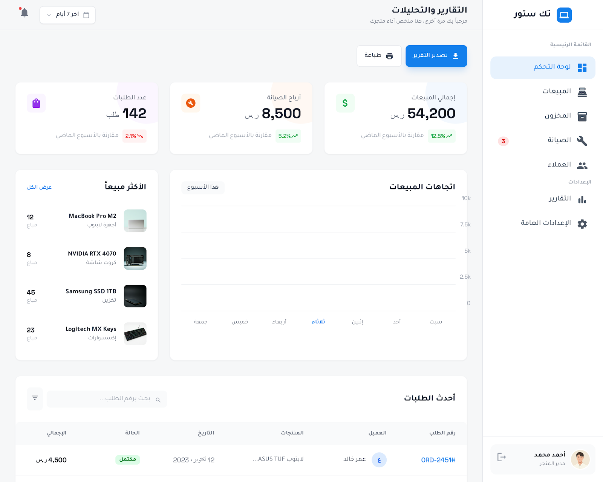

# تك زون للإلكترونيات

نظام نقاط بيع وإدارة محل عربي يعمل **offline بالكامل** داخل نافذة سطح مكتب واحدة.

## كيف يعمل

يدخل الموظف برمز PIN من 4 أرقام، ثم يفتح وردية قبل أي بيع (البيع بلا وردية مفتوحة مرفوض).
من شاشة POS يبحث بالاسم أو SKU أو السيريال، يضيف الأصناف للسلة، ويدفع نقداً أو محفظة أو آجلاً.
بعد إتمام البيع يصدر إيصال قابل للتخصيص مع طباعة حرارية 80mm.
المخزون لا يصبح سالباً أبداً، والكاشير صلاحياته محدودة (لا أسعار شراء ولا أرباح ولا مرتجعات ولا تقارير).
المدير يدير المخزون والفئات والسيريالات، ويشتري أجهزة مستعملة، ويتابع تذاكر الصيانة والتقارير.

## المميزات

- 8 صفحات: دخول، نقاط بيع، مخزون، سجل، إيصال، شراء مستعمل، صيانة، تقارير.
- واجهة عربية RTL مع وضع ليلي، ومتجاوبة مع زر جوال (`tz-menu` للشريط و`cart-fab` للسلة).
- نافذة سطح مكتب واحدة `maximized` بعنوان يتبع اسم المحل (`syncTitle`).
- إيصال قابل للتخصيص (شعار/تذييل/باركود/ضريبة/مدفوعات) + طباعة حرارية بعرض `80mm` + نص إيصال بعرض 80 عموداً.
- تتبع سيريالات: بحث بالسيريال، والمنتج المتتبع يتطلب سيريالات بعدد الكمية عند البيع.
- شراء أجهزة مستعملة مع إضافة اختيارية للمخزون كمنتج `USED-<ref>`.
- تذاكر صيانة بست حالات (`REPAIR_FLOW`) مع إضافة قطع تخصم من المخزون.
- تقارير: يومي/شهري، الأعلى مبيعاً، أرباح بضائع وصيانة، نواقص (`qty ≤ min_qty`)، حركات مخزون.
- ورديات بفرق عجز/زيادة من مدفوعات الكاش، ومرتجعات جزئية/كلية تعيد المخزون (مدير فقط).
- دخول PIN مجزأ (ملح + تجزئة) بخوارزمية PBKDF2-SHA256 (200 ألف تكرار) ومقارنة `hmac.compare_digest`.
- يعمل offline تماماً: كل الخطوط والأيقونات محلية في `web/fonts/`، والمبالغ `INTEGER` بوحدات صغرى لتفادي أخطاء التقريب.

## شاشات البرنامج

### دخول

شاشة اختيار المستخدم وتسجيل الدخول برمز PIN.



### نقاط البيع

شاشة البيع: فلتر فئات وبحث وسلة مع شريط الوردية.



### المخزون

جدول المنتجات مع فلاتر وقسم إدارة الفئات (مدير).



### السجل

سجل المبيعات والصيانة مع رابط لمعاينة الإيصال.



### الإيصال

معاينة الإيصال وتخصيصه مع الطباعة الحرارية.



### شراء مستعمل

نموذج تسجيل شراء جهاز مستعمل من بائع (مدير).



### الصيانة

نموذج تذكرة صيانة مع انتقالات الحالة وإضافة القطع.



### التقارير

التقارير والتحليلات: يومي/شهري/أرباح/نواقص/حركات (مدير).



ملاحظة: الصور من التصاميم المرجعية وقد تختلف تفاصيل الواجهة الفعلية قليلاً.

## التثبيت

```powershell
npm install
npm run css
```

يبني `web\app.css` من `web\tailwind.css`. ملاحظة: مجلد `web\fonts\` (23 ملف woff2 ~1MB) مستثنى من git لتقليل الحجم — أعد جلبه بإحدى الطريقتين قبل البناء:

- الطريقة 1: `npm i @fontsource/ibm-plex-sans-arabic @fontsource/cairo @fontsource/space-grotesk` ثم انسخ ملفات `woff2` المطلوبة إلى `web\fonts\` بالأسماء التي يشير إليها `web\tailwind.css`.
- الطريقة 2: حمّل ملفات `woff2` من Google Fonts (عائلات IBM Plex Sans Arabic وCairo وSpace Grotesk + أيقونات Material) وضعها في `web\fonts\` بنفس الأسماء، ثم شغّل `npm run css`.

## التشغيل

```powershell
python app\main.py
```

## الفحص

```powershell
python app\selfcheck.py
```

يطبع أسطر `PASS` ويعيد `0` عند النجاح (`ALL 40 CHECKS PASSED`). يستخدم قاعدة بيانات مؤقتة عبر متغير `SHOP_DB`.

## الدخول الافتراضي (PIN من 4 أرقام)

| المستخدم | الاسم | الرمز |
|---|---|---|
| `admin` | المدير | `1234` |
| `cashier` | أحمد محمد | `1111` |

## قاعدة البيانات

المسار الافتراضي: `%LOCALAPPDATA%\TechZone\shop.db` (يُنشأ تلقائياً).
للتجاوز (فحص/اختبار): عيّن متغير البيئة `SHOP_DB` إلى مسار ملف آخر.

ملاحظات:

- المبالغ تُخزَّن `INTEGER` بوحدات صغرى (1 وحدة عملة = 100) لتفادي أخطاء التقريب.
- لا يُسمح بمخزون سالب، ولا بيع بدون وردية مفتوحة (المدير يرى الأرباح وأسعار الشراء؛ الكاشير لا).
- `settings` تشمل: `store_name`، `store_address`، `store_phone`، `currency` (ر.س)، `tax_rate` (15%)، إضافة إلى `store_email` و`store_cr` و`store_vat` وخيارات تخصيص الإيصال (`receipt_thanks` و`receipt_footer` والشعار وأعلام الإظهار).

## للمطور / للذكاء الاصطناعي

المصدر الحي للحقيقة: [AGENTS.md](AGENTS.md) — يغني عن قراءة الكود كاملاً. **قاعدة إلزامية:** أي تعديل/إضافة/حذف في المشروع يجب تضمينه في `AGENTS.md` في نفس الـ commit (القسم المتأثر + سطر في سجل التغييرات).
